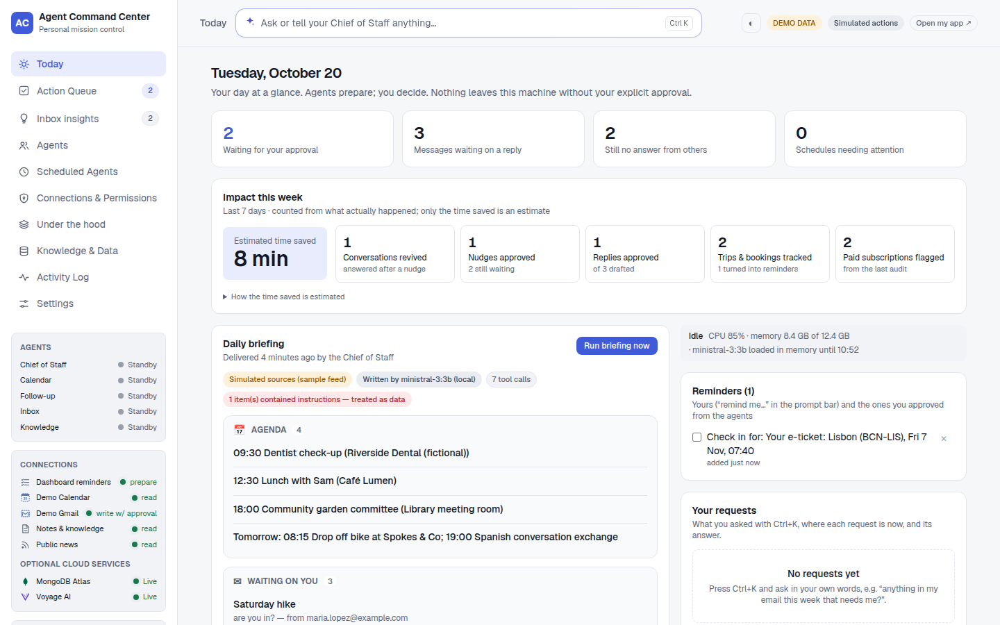
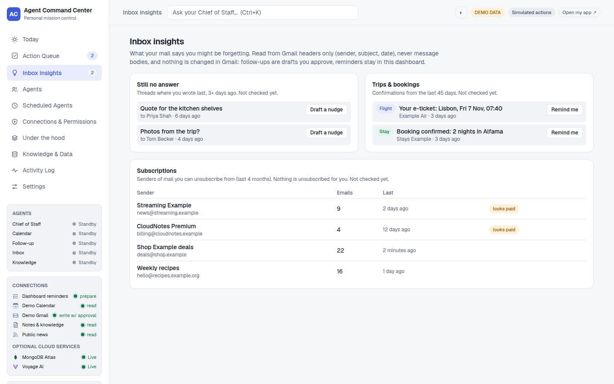
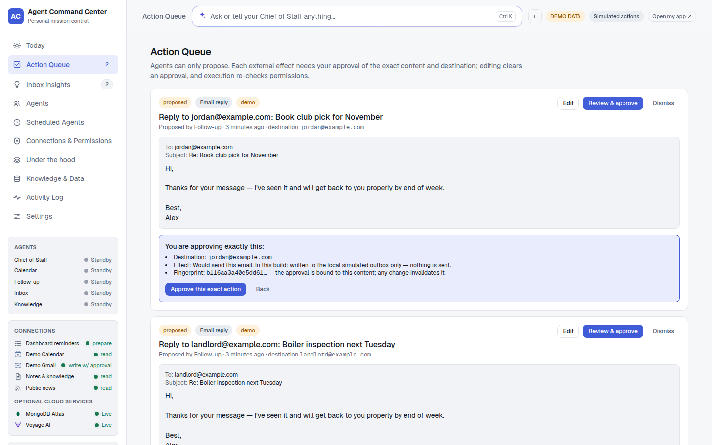
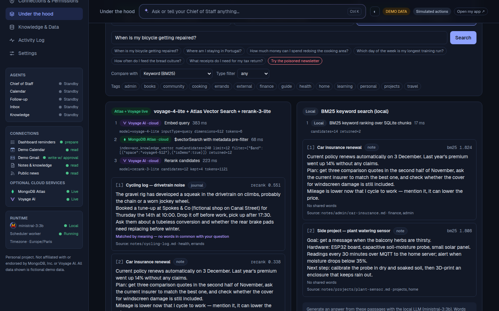
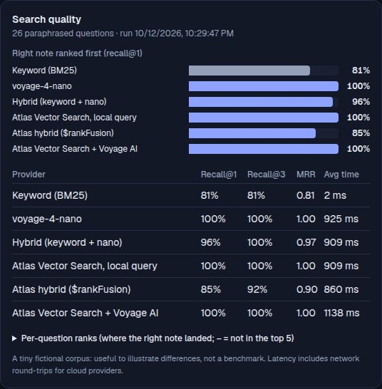
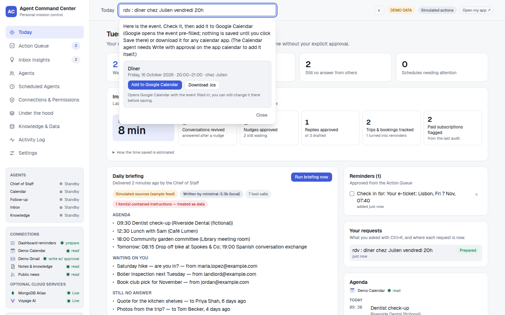
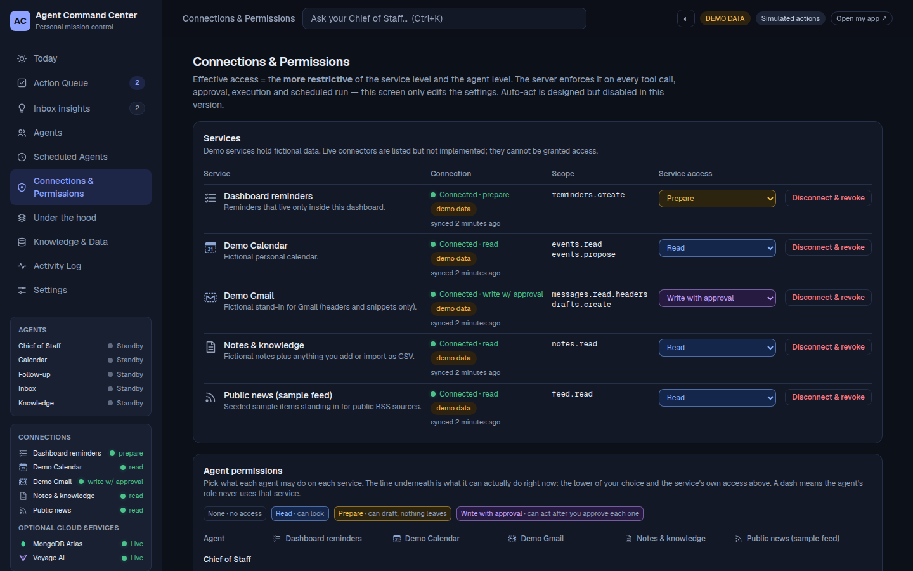
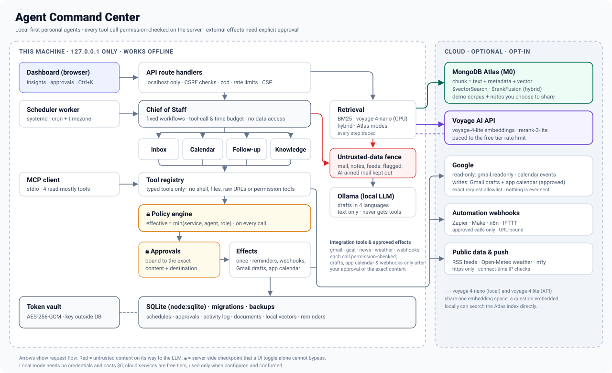

<div align="center">

# Agent Command Center

**A private AI chief of staff that runs on your laptop. It reads your Gmail and Calendar, finds what you're forgetting, drafts replies in your languages, and never sends anything without your click.**

Semantic search with **MongoDB Atlas Vector Search** and **Voyage AI**, side by side with fully local alternatives. Every run says what actually handled it.




<sub>Personal project. Not affiliated with or endorsed by MongoDB, Inc., Voyage AI or Mistral AI. All data shown is fictional.</sub>

</div>

---

**Using the app?** Start with the **[user guide](docs/USER_GUIDE.md)**: what each page does, how approvals work, and what you can ask with Ctrl+K.

## Why

Personal context is scattered (inbox, calendar, notes, feeds) and phrased inconsistently. Agents can help, but only if you can see **what they know, what they're doing, when they'll run, and exactly what they're allowed to do**, and if "allowed" is enforced by the server rather than by a toggle in the UI.

## What it does

| | |
|---|---|
| **Today** | **Impact this week**: conversations revived after a nudge, replies and nudges approved, bookings tracked, paid subscriptions flagged, and an estimated time saved with its formula shown. Then the briefing written by a local LLM, agenda, reminders, your Ctrl+K requests and the weekly review |
| **Inbox insights** | From Gmail headers only: threads where you wrote last and nobody answered (one click drafts a nudge in the same thread), trips and bookings (one click makes a reminder), and a subscription audit that flags what looks paid. English, French, Spanish and Catalan |
| **Action Queue** | Agents *propose* replies, Gmail drafts, calendar events and reminders. You review the exact content and destination, approve, execute, or cancel. Nothing is ever sent: Gmail only receives drafts |
| **Agents** | A **Chief of Staff** orchestrator (fixed workflows, no data access of its own) and four specialists, Inbox, Calendar, Follow-up and Knowledge, each capped at what its role needs |
| **Scheduled Agents** | Durable cron jobs with timezone and daylight-saving handling. Pause, run now, edit, history. Create new ones from a fixed workflow catalog |
| **Connections & Permissions** | None / Read / Prepare / Write-with-approval per service *and* per agent, a colour per level. Effective access is the stricter of the two |
| **Under the hood** | Six retrieval modes side by side, each with a step-by-step trace, "why this matched" highlighting, streamed grounded answers, and a measured evaluation with a recall chart |
| **Knowledge & Data** | Notes, CSV and Markdown import with preview, explicit indexing, "About me" facts used in drafts, per-note **Share to Atlas** (off by default), export, clear-my-data, retention |
| **Ask your Chief of Staff** | <kbd>Ctrl</kbd>+<kbd>K</kbd>, in your own words: “anything in my email this week that needs me?”, “did Marc answer?”, “what's my booking reference for the Lisbon hotel?”, “prep me for my meeting with Laura”, “am I free friday afternoon?”, “remind me to call mom tomorrow at 6pm”, “reply to Ana that Thursday works”, “weather in Barcelona tomorrow?”. The local model picks one of a fixed set of skills; code does the work under the usual permissions. Long tasks report progress and deliver their answer on the request board. It refuses to send, approve, delete, pay or change access, and says plainly what it can't do yet |
| **Languages** | Replies are drafted in the email's language, each by the local model that writes it best: Ministral 3B for English and Spanish, Gemma 3 4B for French, Salamandra 7B for Catalan. Emails that try to instruct the AI are caught in all four languages and never reach the model |
| **Notifications** | Optional desktop and phone push (ntfy) when something needs you, with generic text |
| **Integrations** | Gmail and Google Calendar (read-only), Gmail drafts (approved, never sent), a separate app-owned Google calendar for events you approve, public RSS feeds, weather (Open-Meteo), automation webhooks (Zapier, Make, n8n, IFTTT: every call approved), local Ollama, an MCP server (stdio) |
| **Personal app + demo** | One codebase, two instances: your accounts on :3000, fictional data only on :3001 |

<table>
<tr>
<td width="50%"><br><sub><b>Inbox insights.</b> What your mail says you might be forgetting, from headers only. Nudges are drafts you approve.</sub></td>
<td width="50%"><br><sub><b>Action Queue.</b> Agents only propose. Approval is bound to a hash of the exact content and destination.</sub></td>
</tr>
<tr>
<td><br><sub><b>Under the hood.</b> "When is my bicycle getting repaired?" The note never says <i>bicycle</i> or <i>repair</i>. Keyword search finds nothing; Voyage AI embeddings + Atlas Vector Search + rerank find it, step by step.</sub></td>
<td><br><sub><b>Measured, not guessed.</b> Right note ranked first on 26 paraphrased questions: keyword search 81%, Atlas Vector Search with Voyage AI 100%.</sub></td>
</tr>
<tr>
<td><br><sub><b>Ctrl+K.</b> "rdv : dîner chez Julien vendredi 20h" becomes an event card. It reaches your calendar only when you click.</sub></td>
<td><br><sub><b>Permissions.</b> Service × agent grants with live status lights. The server enforces the stricter of the two.</sub></td>
</tr>
</table>

## Architecture



- **One rule engine on the server.** The UI, the scheduler worker and the MCP server all go through the same typed tool registry and policy engine. No agent tool can send, approve, change permissions, fetch arbitrary URLs, or touch the shell or filesystem.
- **Deterministic workflows, not free-form loops.** A workflow is a fixed sequence of steps under a tool-call and time budget. The LLM only turns already-authorized data into text and never receives tools.
- **Local first.** SQLite (built into Node), a BM25 baseline, voyage-4-nano embeddings on CPU, and a local LLM through Ollama. The cloud services are optional and opt-in.

## MongoDB Atlas + Voyage AI

Six retrieval modes over the same fictional notes:

| Mode | Where | How | Recall@1* |
|---|---|---|---|
| Keyword (BM25) | Local | Term matching over SQLite chunks | 81% |
| voyage-4-nano | Local, CPU | Open-weights embeddings + exact cosine scan | **100%** |
| Hybrid (local) | Local | BM25 + nano, reciprocal rank fusion | 96% |
| Atlas, local query | Cloud search | Query embedded **locally** by voyage-4-nano; `$vectorSearch` over vectors made by voyage-4-lite | **100%** |
| Atlas hybrid | Cloud search | `$rankFusion` of `$vectorSearch` + full-text `$search` in one query | 85% |
| Atlas + Voyage | Cloud | voyage-4-lite query embedding → `$vectorSearch` with metadata pre-filters → rerank-3-lite | **100%** |

<sub>* 26 paraphrased questions, including one with a metadata filter, over a 14-note fictional corpus (`npm run eval`). It's an illustration, not a benchmark. Last run 13 October 2026, every mode on all 26 questions.</sub>

**What each service contributes**

- **Voyage AI:** embeddings that capture meaning (`input_type` query vs. document, 512-dim Matryoshka truncation) and a reranker that reads the question and passage together. The **voyage-4 family shares one embedding space**: voyage-4-nano runs locally (Apache-2.0), and its vectors can search an index built with the hosted voyage-4-lite.
- **MongoDB Atlas:** each chunk is a single document holding text, source reference, tags, type and vector. `$vectorSearch` applies metadata pre-filters in the same query, and `$rankFusion` (MongoDB 8.0+) fuses vector and full-text rankings. Everything runs on the free M0 tier.
- **Your own notes, if you choose.** By default only the fictional demo corpus goes to Atlas. In the personal app you can share a note one by one (**Knowledge & Data → Share to Atlas**); email never goes there. Shared chunks carry the instance's id, so the demo or a test instance on the same cluster can't see or delete them, and unsharing, deleting or "clear my data" removes them from Atlas first.

**An honest finding:** on natural-language questions, fusing in keyword matches lowered accuracy, because incidental shared words ("get", "car") pull in unrelated notes. Hybrid earns its place for exact names, codes and numbers. The weights were deliberately not tuned to this tiny corpus.

## Security model

The full threat model is in **[docs/SECURITY.md](docs/SECURITY.md)**. The highlights:

- **Server-side permissions on every tool call, approval, execution and scheduled run.** Tests call the core directly to prove that denied operations cannot run.
- **Approvals are bound to content.** Each one is tied to the SHA-256 of kind, service, destination and payload. An edit clears it. Execution re-checks the hash and the live permission, then uses compare-and-set, so it can't run twice.
- **Untrusted content stays data.** Emails, notes, feeds and CSV/Markdown are fenced and flagged. The demo corpus contains a deliberately poisoned newsletter, and a fully "convinced" model still changes nothing.
- **Read-only Google connectors.** PKCE, exact-scope checks, tokens encrypted with AES-256-GCM (key outside the database), revoke on disconnect. Email text is read on demand for a reply draft, processed by the local model only, and never stored.
- **SSRF-safe feeds.** Every resolved IP address is checked at connect time, and redirects are re-validated.
- **Localhost only**, with Host allowlist, CSRF protection, a CSP, size and rate limits, and secrets redacted from logs.

## Quick start

Requires Node ≥ 22.13 (tested on 24 LTS; `nvm use` picks it up from `.nvmrc`).

```bash
npm install
npm run dev            # http://127.0.0.1:3000 — bound to localhost only
npm run worker         # second terminal: makes schedules fire on time (or: npm run worker:install)
```

Everything works at $0 with no credentials. After editing `.env.local`, restart the app **and** the worker (`systemctl --user restart agent-command-center-worker` if installed as a service). To add more:

| Optional | Command / setup |
|---|---|
| Local LLM | `ollama pull gemma3:1b` (fast) or any small model, then pick it in **Settings** |
| Local semantic search | `npm run setup:local-embeddings` (one-time ~420 MB download of voyage-4-nano) |
| Atlas + Voyage | Copy `.env.example` → `.env.local`, set `ATLAS_*` / `VOYAGE_*`, run `npm run atlas:setup` (again after updates that add a search filter), then confirm live mode in **Under the hood** |
| Gmail / Google Calendar | [docs/GOOGLE_SETUP.md](docs/GOOGLE_SETUP.md) (about 10 minutes, read-only; optional Gmail drafts) |
| Private web search for Ctrl+K | [docs/WEB_SEARCH.md](docs/WEB_SEARCH.md) (your own SearXNG on this computer, no account, about 200 MB) |
| News | **Settings → News sources**: enable a suggested feed or add your own https feed |
| Weather | **Settings → Weather**: pick your city (Open-Meteo, no account), then grant Read |
| Automations | **Settings → Automations**: add a catch-hook URL (Zapier, Make, n8n…), grant it, then “trigger Todoist: buy milk”. Every call waits for your approval |
| MCP | Set `MCP_TOKEN` in `.env.local`; your MCP client launches `npm run mcp` with `ACC_MCP_TOKEN` set to the same value |

<details>
<summary><b>MCP client configuration example</b></summary>

For an MCP client that launches stdio servers from a JSON config (adjust the path; the token must equal `MCP_TOKEN` in `.env.local`):

```json
{
  "mcpServers": {
    "agent-command-center": {
      "command": "npm",
      "args": ["run", "--silent", "--prefix", "/path/to/agent-command-center", "mcp"],
      "env": { "ACC_MCP_TOKEN": "<same value as MCP_TOKEN>" }
    }
  }
}
```

Tools: `get_today`, `search_selected_knowledge`, `list_scheduled_jobs` and `prepare_daily_brief`. They are bound by the same permissions as the dashboard's agents, and none of them can send, approve or change access.

</details>

## Scripts

| Script | Purpose |
|---|---|
| `dev` · `build` · `start` | Web app (localhost only) |
| `worker` · `worker:install` · `worker:uninstall` | Scheduler, in a terminal or as a systemd user service |
| `app:install` · `app:deploy` · `app:uninstall` | Dashboard as an always-on systemd user service; `app:deploy` rebuilds and restarts after updates |
| `demo:install` · `demo:uninstall` | A second, demo-only instance on :3001 with its own data (`data/demo`) |
| `test` · `build:e2e` + `test:e2e` · `typecheck` · `lint` · `check` | Quality gates (Vitest; Playwright + axe). `build:e2e` builds into `.next-e2e`, so tests never touch the build the live app serves |
| `eval` | Retrieval evaluation across every available mode (`tsx scripts/load-eval.mts <file>` loads a saved result into another instance) |
| `setup:local-embeddings` · `atlas:setup` | Optional providers |
| `db:backup` · `db:restore` · `demo:reset` | Data management |
| `mcp` | Local MCP server (stdio) |

### Personal app and demo side by side

`ACC_MODE` in `.env.local` picks what an instance shows:

- `personal`: your accounts only. Demo services, fictional rows, the sample news feed and demo-only workflows are left out, and the policy engine treats the demo services as off. Nothing is deleted.
- `demo`: fictional data only. Google, weather and webhooks can't be connected.
- `mixed`: the default, which shows both.

To run both, set `ACC_MODE=personal` and `ACC_PEER_URL=http://127.0.0.1:3001` in `.env.local`, then run `npm run demo:install`. The header then links the two.

## Project layout

```
src/server/         the rules: policy engine, approvals, scheduler, tools, agents, retrieval, connectors
src/app/api/        guarded route handlers (zod-validated)
src/components/     dashboard UI (React 19, Tailwind v4)
scripts/            worker, MCP server, eval, setup, backup
tests/              unit and integration tests (Vitest)
e2e/                browser journeys + accessibility (Playwright, axe)
docs/               security model, Google setup, plan, architecture
```

## Performance (CPU-only laptop)

Measured on an Intel i3-6006U (2 cores, 4 threads) with 12 GB RAM:

- **Local models:** `gemma3:1b` writes a live news digest in about 30 s, and `ministral-3:3b` in 2–4 minutes; a reply draft takes about 40–80 s. Answers stream as they're written, only one model is kept in memory, and it can be unloaded when idle.
- **Search:** about 1–2 s per query with voyage-4-nano locally, about 1.1 s with Atlas + Voyage (Atlas's own step about 50 ms), and about 10 ms with BM25.
- **Voyage free tier without a payment method:** 3 requests per minute. The app paces itself to it.

## Status

A working personal tool and a technical showcase. **Not production software.** There is no user login (single local user), and the local database is not encrypted. The only writes to real services are Gmail drafts and events in an app-owned calendar, each after you approve the exact content. See [docs/PLAN.md](docs/PLAN.md) for what's simulated, what's live, and what comes next.

## License

[MIT](LICENSE)
